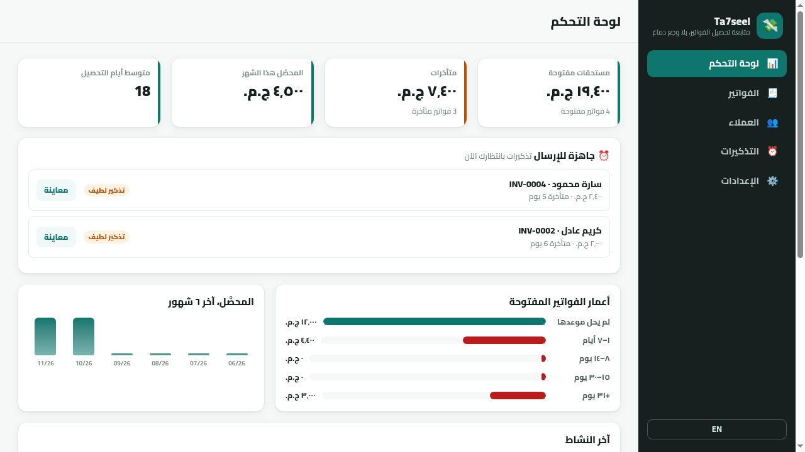
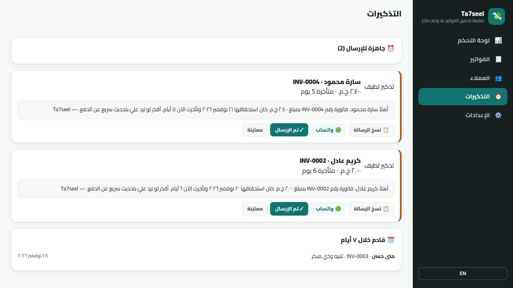
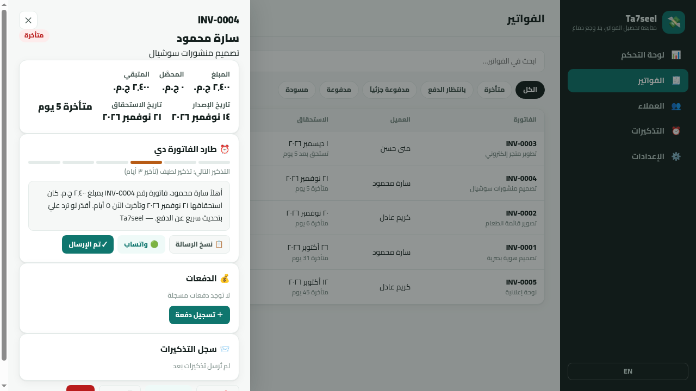
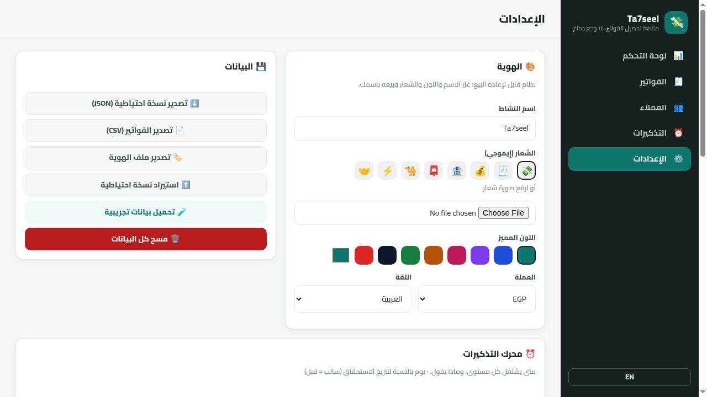
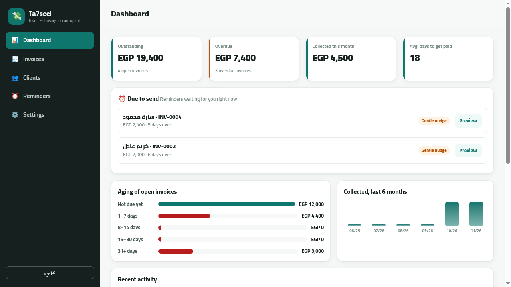
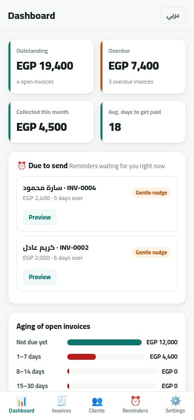

# Ta7seel — تحصيل


**Invoice chasing for freelancers, without the awkward part.**
Ta7seel (تحصيل, Arabic for "collection") tracks who owes you what and tells you exactly when to nudge, with ready-to-send reminder messages that escalate from friendly to firm.

**Live app:** https://yousefkhames.github.io/ta7seel/

No sign-up, no server, no cost. Open the link and your data stays in your own browser.

---

## The problem

Freelancers lose real money not because clients refuse to pay, but because following up is awkward and easy to postpone. Ta7seel turns "I should probably remind them" into a list of specific messages, ready today, in your client's language.

## Features

- **Escalation ladder** — six reminder levels (friendly heads-up → due-date note → nudge → firm follow-up → final notice → last call), each firing at a configurable offset from the due date. Disable levels or change their timing.
- **Ready-to-send messages** — every reminder is a pre-written message with the client name, invoice number, balance, due date and days-overdue filled in. Copy it, or open it straight in WhatsApp. Editable templates in both languages.
- **Invoice tracking** — partial payments, full-payment shortcut, automatic status (draft / awaiting / partly paid / overdue / paid), search and status filters.
- **Dashboard** — outstanding and overdue totals, collected this month, average days-to-get-paid, aging buckets (current → 31+ days), and a 6-month collection trend.
- **Clients** — per-client open balance, overdue amount, and invoice history.
- **Bilingual** — full Arabic and English UI with proper RTL layout. One-tap language switch.
- **White-label** — rename the business, swap the logo (emoji or image), recolor it, change the currency, and export the whole identity as a **brand kit** JSON you can import into any other copy of the app. Built to be resold to local businesses.
- **Your data, portable** — full JSON backup/restore and CSV export of invoices.
- **Mobile-first** — bottom-tab navigation on phones, sidebar on desktop. Works offline after first load.

## Screenshots

| Dashboard (Arabic, RTL) | Reminder center |
| --- | --- |
|  |  |

| Invoice detail with next reminder | Settings / white-label |
| --- | --- |
|  |  |

| English (LTR) | Mobile |
| --- | --- |
|  |  |

## Tech

Plain HTML/CSS/JS. No frameworks, no build step, no dependencies beyond a Google Font.

- `js/core.js` — pure business logic (dates, money, statuses, aging, ladder, templates, CSV), shared between the browser and Node
- `js/app.js` — UI, state, localStorage
- `js/i18n.js` — Arabic/English dictionaries + default reminder templates
- `tests/core.test.js` — 27 unit tests on `node:test`

Run the tests:

```bash
node --test tests/core.test.js
```

## Honest limits

- **Local only.** Data lives in your browser's localStorage. Clearing site data erases it; another device won't see it. Use the JSON backup to move or safeguard data.
- **Reminders don't send themselves.** Ta7seel tells you what to send and when, and hands you the message — you press send. There is no email/SMS integration.
- **No multi-user or accounts.** It's a single-user tool by design.
- **Print is basic.** The print view is the invoice drawer, not a designed PDF invoice.
- Needs internet for the first visit only; the Cairo font is bundled in `fonts/`, no third-party requests. Afterwards it works offline.

## License

[MIT](LICENSE) — use it, rebrand it, sell it.

## Round 2 review notes
- Inputs accept Arabic-Indic digits and decimal commas; absurd values are ignored instead of breaking totals.
- Backup import is sanitised and asks for confirmation before replacing data; failed saves show a message.
- Limits: WhatsApp links are only checked as generated wa.me URLs (not opened in the WhatsApp app); no cloud sync, data stays in this browser.
- Offline: a service worker precaches the app shell and the bundled fonts (added in round 2 review).
